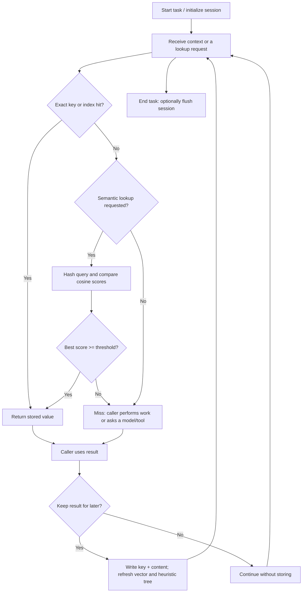
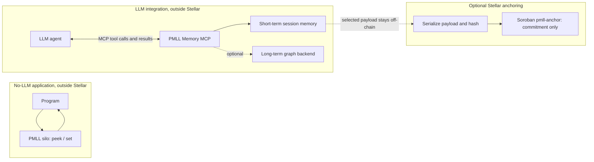

# PMLL: short-term memory and logic-loop model

PMLL means **Persistent Memory Logic Loop**. Technically, it is a software pattern and implementation for storing, retrieving, and updating task context around a caller's work. It is not an LLM, a trained neural network, or a hardware circuit. “Circuit” is a useful metaphor for the repeatable retrieve → act → record cycle; the implemented components are ordinary data structures, lookup/scoring routines, and optional control-flow or logic modules.

## What the short-term memory is

At its core, the C implementation (`PMLL.h` / `PMLL.c`) provides a bounded `memory_silo_t`:

- **Slots:** each resolved slot holds an optional exact key, text content, and a 32-dimensional feature-hash vector.
- **Write:** `silo_set` stores/replaces a key and content and computes the content vector. A negative index requests the next free slot.
- **Exact read:** `peek` finds an exact key, or reads by index when no key is supplied. It is non-destructive.
- **Approximate read:** `peek_semantic` hashes query tokens in the same way, compares vectors by cosine similarity, and returns the best slot only when it meets `min_sim`.
- **Tree/cache hint:** `update_silo` also propagates an integer value across a bounded parent/child index tree. This is a lightweight heuristic hint/cache; it is **not** a learned associative graph, a semantic relation graph, or a reliable substitute for the slot contents.

The C silo is allocated in process memory and is therefore **volatile by itself**. Persistence across process restarts depends on the surrounding host or storage backend. The MCP server adds session-oriented memory tools and may use configured backing storage; that is separate from the in-memory C data structure.

The built-in text representation is deliberately small and dependency-free: tokenize text, lowercase tokens, hash tokens into 32 dimensions, normalize, then compare by cosine. This is lexical feature overlap, not a transformer embedding: collisions are possible, word order and much of language meaning are lost, and a high score is only a retrieval heuristic—not proof that a result is relevant.

## The loop

A more compact view is `retrieve → decide/act → optionally store → retrieve again`. PMLL provides the memory operations; the application decides what to remember, when to retrieve, and how to use a result.

## No-LLM use

A deterministic program can use the same loop without any model: initialize a silo, store facts/results under stable keys, call `peek` before repeating expensive work, optionally call `peek_semantic` for approximate token-overlap retrieval, handle a miss in ordinary application code, then `silo_set` the result. The application owns policy, validation, and response generation. Optional C SAT helpers are a separate bounded Boolean-logic facility; they do not turn PMLL into general reasoning or natural-language understanding.

## Use as a tool for an LLM

An LLM can use PMLL through an integration such as the **PMLL Memory MCP server**. The model remains the language/reasoning component; PMLL is an external, explicitly invoked memory tool. A typical orchestration is:

1. The host initializes a task/session silo.
2. Before costly work, the agent requests an exact lookup (and, where supported and appropriate, a semantic lookup).
3. On a hit, the host returns the stored text to the model as tool output. On a miss, the model/agent performs the work using its other tools.
4. The agent or host explicitly stores a useful result with a stable key.
5. The cycle repeats; task-end flushing and longer-term promotion are host/application policy.

The MCP boundary is useful outside Stellar and does not require the model to share PMLL's process or language runtime. Tool availability and exact names depend on the TypeScript or Python server implementation; consult that server's tool reference rather than assuming every build exposes identical operations.

## Outside and inside the Stellar ecosystem

**Outside Stellar:** use the C/Python interfaces or an MCP server as a conventional off-chain memory component. No wallet, network, token, or smart contract is needed. A configured local/server-side store controls scope and persistence.

**Inside Stellar:** the same working memory and agent loop remain off-chain. If desired, a typed off-chain `CodeworkPayload` can be serialized and hashed to a 32-byte digest, then the digest can be submitted as a commitment to the existing Soroban `pmll-anchor` contract. The anchor's documented ABI is `init` / `store` / `get` / `bump`. The contract records or returns a commitment; it does **not** store the natural-language memory, provide semantic search, or replace the silo/MCP server. The payload must remain available off-chain if it is to be read again. A digest can support integrity/anchoring checks when compared with a candidate payload, but does not establish that the payload is true, keep it available, or make it private.

## Related components and boundaries

- **PMLL memory/state:** silo slots and retrieval/update operations.
- **Q-promise:** optional temporal/control-flow layer for pending work and continuations. It can reference a memory key and commit a result back; it does not replace the silo.
- **MCP / Context+ graph:** integration layers that expose tools and, when configured, add longer-term graph memory. These are distinct from the minimal C silo.
- **SAT bridge/refinement:** a separate Boolean clause/assignment facility. It is not an LLM, not a general-purpose memory index, and not proof that arbitrary text has been reasoned about.
- **Stellar `pmll-anchor`:** optional on-chain commitment surface, not memory storage or retrieval.

## Practical caveats

Treat retrieved values as untrusted application data: check scope/session identity, freshness, and suitability before acting. Choose stable, non-sensitive keys; control retention and access in the host/backend; avoid writing secrets to shared or public stores. Semantic matching is a best-match heuristic and can return an irrelevant result, so callers should allow misses and validate hits. The in-memory C API and Q-promise implementation have process/threading constraints; in particular, the documented Q-promise drain is single-threaded and callers must serialize access.
